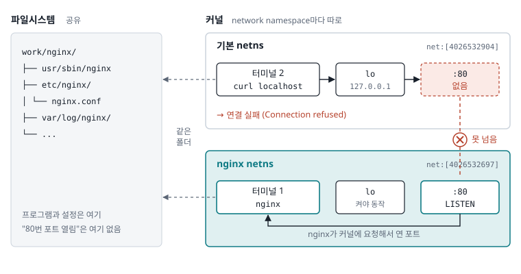
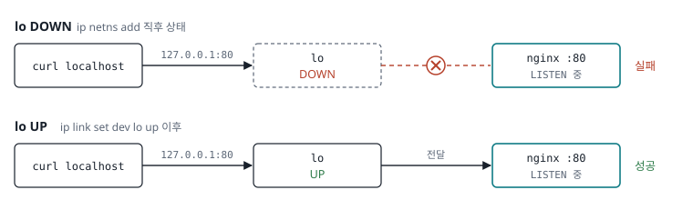
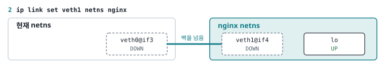
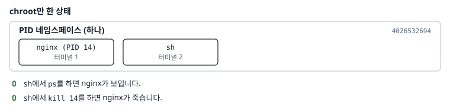
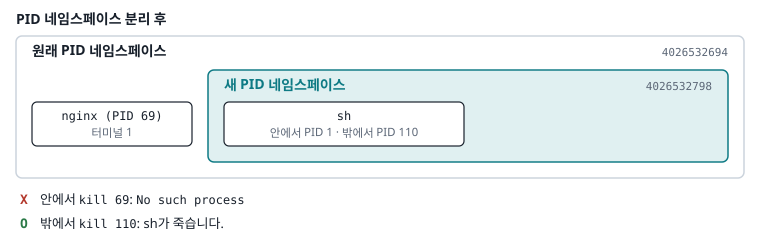

# 도커

## 목표

도커가 어떻게 구성되어있는지 간략하게 확인

## 실습 환경

Mac에서는 chroot, namespace, cgroup을 직접 쓸 수 없으므로 리눅스 컨테이너 안에서 실습한다.

| 항목 | 값 |
| --- | --- |
| 위치 | [labs/linux-container](../labs/linux-container) |
| 베이스 이미지 | `ubuntu:24.04` |
| 이미지 이름 | `linux-lab` |
| 실행 | `./labs/linux-container/run.sh` (빌드 후 셸 접속) |

설치된 도구

| 용도 | 도구 |
| --- | --- |
| namespace | `unshare`, `nsenter`, `lsns` |
| 네트워크 | `ip`, `iptables`, `ping` |
| 프로세스 확인 | `ps`, `pstree` |
| chroot용 rootfs | `busybox-static`, `debootstrap` |
| 시스템콜 | `strace`, `gcc` |

`run.sh` 실행 옵션

| 옵션                | 이유 |
|-------------------| --- |
| `--rm`            | 나오면 컨테이너 자동 삭제 |
| `--privileged`    | chroot, mount, unshare 권한 허용 |
| `--cgroupns=host` | cgroup 직접 생성, 수정 |
| `-v work:/environment`     | `work/` 폴더를 컨테이너 `/environment`과 공유. 컨테이너가 삭제돼도 실습 파일이 남음 |

## 실습

### 기초 컨테이너 분리

1. 실습 run.sh 실행

2. 새로운 루프 디렉토리 설정을 폴더 및 bin 생성
```
mkdir -p project-a/bin
```

3. root를 변경
chroot를 사용하게 되면 그 변경하는 곳의 /bin/sh를 확인하게 된다.
이는 `chroot {폴더} {명령어}`와 같이 명령어를 실행하려 하지만 /bin이 없어서 실패하게 되기 때문
```
cp /bin/sh project-a/bin/
```

4. sh를 실행하기 위해 필요한 라이브러리 연관성 확인
/bin/sh를 실행핟기 위해서는 일부 라이브러리들이 필요하다
```
ldd /bin/sh
```
> root@linux-lab:/environment/project-a/bin# ldd /bin/sh
        linux-vdso.so.1 (0x0000ffff9872c000)
        libc.so.6 => /lib/aarch64-linux-gnu/libc.so.6 (0x0000ffff984f0000)
        /lib/ld-linux-aarch64.so.1 (0x0000ffff986f0000)

5. 필요한 라이브러리 copy
```
{
    mkdir -p project-a/lib/aarch64-linux-gnu
    
    cp /lib/ld-linux-aarch64.so.1 project-a/lib/
    cp /lib/aarch64-linux-gnu/libc.so.6 project-a/lib/aarch64-linux-gnu/
}
```

6. 루트 디렉토리 변경

변경하기 전
```
pwd => /environment/project-a
```

```
chroot project-a/
```

```
pwd => /
```

참고. clear를 하면 해당 명령어를 /bin에 등록하지 않았기 때문에 불가능하다

여기가찌가 도커로 새로운 컨테이너 환경을 만들고 해당 컨테이너로 `docker exec -it /bin/sh`를 하여 root를 기반으로하는 컨테이너에 들어가는 것과 같다.

## Nginx

1. nginx 컨테이너 생성
```
docker create --name nginx nginx
```


2. nginx 컨테이너에 포함된 파일들을 저장할 디렉토리 생성
기존 proejct-a했던 linux container에 추가
```
mkdir nginx

ls => nginx  project-a
```
 
3. 파일 복사
초기 nginx를 실행하기 위해 필요한 모든 파일들을 가져온다 생각하면됨 (테스트하기 위함)
```
cd labs/linux-container

docker cp $(docker container ls -aq -f name=nginx):/ ./work/nginx
```

4. nginx 컨테이너가 실행될때 수행되는 명령어 확인
```
docker inspect $(docker container ls -aq -f name=nginx) --format='{{.Config.Cmd}}'
```
- [nginx -g daemon off;]

5. nginx 실행
```
chroot nginx

nginx -g "daemon off;"
```

6. 확인
새로운 터미널에서 실행중인 컨테이너 찾기 및 컨테이너 접속
```
docker ps

docker exec -it <<컨테이너 ID>> bash

curl localhost
```

## namespace 연결
지금까지 chroot로 `파일 시스템`만 분리했다면 이제는 그 나머지를 분리하는 과정
네트워크 리소스를 격리하여 서로 간섭이 되지 않도록 해야한다.

### namespace 종류
| namespace | 분류 | 결과 |
| --- | --- | --- |
| PID | 프로세스 번호 | 안에서 `ps`를 하면 자기 프로세스만 보이고, 첫 프로세스가 PID 1 |
| Mount | 마운트 목록 | 안에서 mount해도 바깥에 영향 없음 |
| UTS | hostname | 안에서 hostname을 바꿔도 바깥은 그대로 |
| Network | 네트워크 장치, IP, 포트, 라우팅 | 자기만의 `localhost`와 IP |
| IPC | 프로세스 간 공유 메모리, 메시지 큐 | 다른 컨테이너와 공유 메모리를 못 씀 |
| User | UID, GID | 안에서는 root(0)지만 바깥에서는 일반 사용자 |
| Cgroup | cgroup 트리가 보이는 범위 | 자기 cgroup만 보임 |
| Time | 시스템 부팅 후 경과 시간 | 컨테이너마다 다른 uptime (잘 안 씀) |


### network namespace

1. 새로운 네트워크 네임스페이스 생성
```
ip netns add nginx

ip netns list
```

2. 생성한 네트워크 네임스페이스의 네트워크 디바이스 목록 확인
```
ip netns exec nginx ip -br link
```
- `lo DOWN 00:00:00:00:00:00 <LOOPBACK>` 

lo(loopback) 장치가 다운되어 있다

현재 까지의 상태
```
nginx를 켜 놓은 상태에서 
- 해당 컨테이너에 curl localhost 가능
- chroot nginx로 하는경우 curl localhost 가능

```
- 하나의 컨테이너에서 같은 namespace를 현재 사용중이기 때문에 전부 가능

```
ip netns exec nginx chroot nginx nginx -g "daemon off;"

or

ip netns exec nginx chroot nginx
nginx -g "daemon off;"
```
- nginx라는 newtwork namespace로 `nginx`파일 시스템을 root로 변경하는 작업이다.
- 이렇게 하면 기존 namespace와 분리가 되는 상태가 된다.



이후 같은 namespace로 접근하여 `curl localhost`로 해도 실패를 하게 됩니다.
```
ip netns exec nginx chroot nginx
curl localhost
```
이렇게 해도 실패하는 이유는 namespace에 어떤 lan을 연결하지 않았기 때문입니다.
localhost를 부르기 위해서는 loopback을 할 수 있는 lo랜카드를 올려야 합니다.


3. 네트워크 네임스페이스의 루프백 인터페이스 구동
```
ip netns exec nginx ip link set dev lo up
```
- `lo UNKNOWN 00:00:00:00:00:00 <LOOPBACK,UP,LOWER_UP>`



4. 웹서버 연결 확인
```
ip netns exec nginx chroot nginx

curl locahost
```
or
```
ip netns exec nginx curl localhost
```

5. 외부와 통신을 위한 veth 가상 랜선 추가

lo랜선의 경우 namespace 안에서만 사용하는 장치라 외부에서 사용하기 위해서는 veth가 필요
- veth는 항상 한 쌍으로 만들어진다.
- 한쪽에서 넣은 패킷은 반대편으로 나온다.

```
ip link add veth0 type veth peer name veth1
```
- ip link add : 네트워크 장치 새로 만들기
- vetho0: 장치 이름
- type veth: 장치 종류
- peer name veth1 : 반대쪽 장치 이름

``
ip -br link

[결과]
lo               UNKNOWN        00:00:00:00:00:00 <LOOPBACK,UP,LOWER_UP>
eth0@if15406     UP             f6:f1:52:e3:b5:0c <BROADCAST,MULTICAST,UP,LOWER_UP>
veth1@veth0      DOWN           b6:41:32:55:9c:c5 <BROADCAST,MULTICAST,M-DOWN>
veth0@veth1      DOWN           ea:a6:2f:04:ab:cd <BROADCAST,MULTICAST,M-DOWN>
``

6. veth1 가상 랜선을 nginx namespace로 옮기기
```
ip link set veth1 netns nginx
```
옮기고 확인하면
```
ip netns exec nginx ip -br link

lo               UNKNOWN        00:00:00:00:00:00 <LOOPBACK,UP,LOWER_UP> 
veth1@if4        DOWN           b6:41:32:55:9c:c5 <BROADCAST,MULTICAST>
```
와 같이 잘 옮겨진 것을 볼 수 있다.



7. 각각에 ip 할당
```
ip addr add 192.168.1.1/24 dev veth0
ip netns exec nginx ip addr add 192.168.1.2/24 dev veth1
```

아직까지 veth를 켜지않아서 ip가 나오지 않는다.
```
ip netns exec nginx chroot nginx
hostname -I => 결과 없음
```

8. veth 가상 랜선 ON
```
ip link set dev veth0 up
ip netns exec nginx ip link set dev veth1 up
```
- `ip -br link`, `ip netns exec nginx ip -br link` 확인

```
root@linux-lab:/environment# hostname -I
192.168.215.3 192.168.1.1

# hostname -I
192.168.1.2 
```

9. nginx 웹 서버 실행 확인
```
curl 192.168.1.2
```

### Pid namespace

1. 기본 세팅
```
# 터미널1
./run.sh
chroot environment/nginx/
nginx -g "daemon off;"

# 터미널2
docker exec -it {id} /bin/bash
chroot environment/ubuntu/ /bin/sh

# 터미널3
ps aux | grep nginx
```
- 터미널3: `root 14  0.0  0.0  14716  2132 pts/0    S+   12:42   0:00 nginx: master process nginx -g daemon off;`

2. 두번째 터미널에서 첫번재 터미널에서 실행한 nginx kill
```
# 터미널2
kill 14
```
- 터미널1의 nginx가 killed

즉 현재까지 두 프로세스는 같은 namespace에 있기때문에 독립적이지 못한 상태이다.



3. 네임스페이스 목록 및 nginx의 PID 확인
[네임스페이스 목록]
```
lsns
```
- `4026532694 pid 19 1 root bash`

[nginx의 pid]
```
ps aux | grep nginx
```
- `root 69  0.0  0.0  14716  1592 pts/0    S+   13:04   0:00 nginx: master process nginx -g daemon off;`

4. nginx가 속한 PID 네임스페이스 확인
```
ls -Li /proc/69/ns/pid
```
- `4026532694 /proc/69/ns/pid`


lsns로 나온 `pid namespace`의 id는 `4026532694`이고 nginx의 pid(프로세스 id)를 기반으로 pid namespace id를 가져온결과 동일하다.


5. sh pid 및 pid namespace id 확인
```
ps aux | grep /bin/sh
ls -Li /proc/{pid}/ns/pid
```

모두 똑같은 id가 나오는 것을 기준으로 같은 PID 네임스페이스에 있는 것을 알 수 있다.

6. proc
proc은 커널이 프로세스와 시스템 정보를 파일 모양으로 보여주는 가상 파일 시스템

`터미널2`에서 `ps`는 `/proc`을 읽어서 프로세스 목록을 만드는데 복사해 온 ubuntu 디렉토리의 /proc은 비어있어서 마운트 하기 전에는 ps가 동작하지 않는다.
[터미널2]
```
chown -R root:root .
mount -t proc proc /proc
```
- proc의 내용은 디스크가 만들어주기 때문에 mount로 생성

7. 새로운 PID 네임스페이스
[터미널2]
```
# 실행중인 프로세스는 자신의 PID 변경불가
exit

unshare --pid --fork chroot /environment/ubuntu/ /bin/sh

# 다시 proc mount
mount -t proc proc /proc

# 프로세스 목록
ps aux
```
- 이렇게 되면 sh pid가 1이 된 상태로 pid namespace가 분리된 것을 확인 가능
- 터미널2에서 터미널1의 프로세스 종료 불가

8. 외부에서 내부 pid 정리
[터미널3]
pid 네임스페이스 목록을 확인해보면 2개가 존재하는 것을 확인 가능
```
lsns -t pid

# 결과
4026532694 pid      19     1 root bash
4026532798 pid       1   110 root /bin/sh
```

[터미널3]
```
# 외부에서 sh pid 확인
ps aux | grep /bin/sh

kill -9 {sh pid}

lsns -t pid
```

