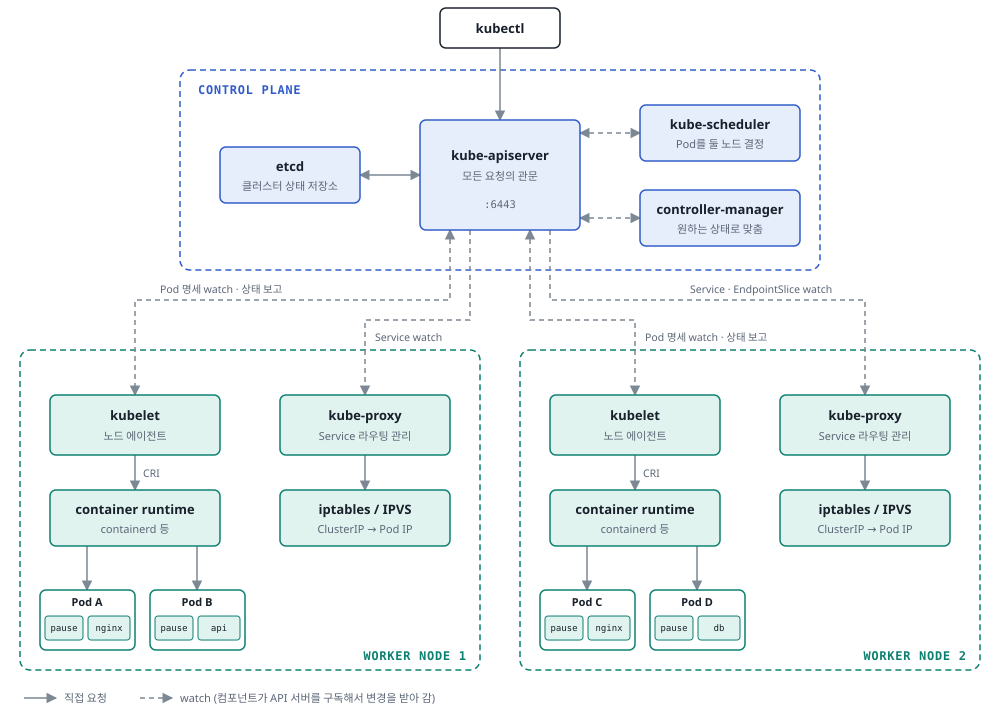
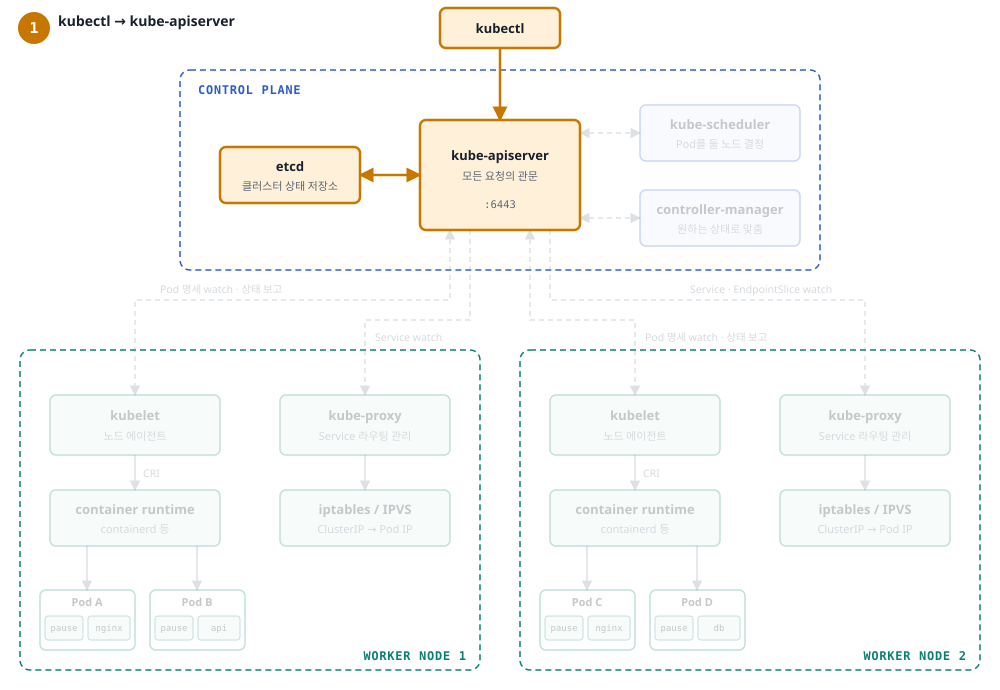
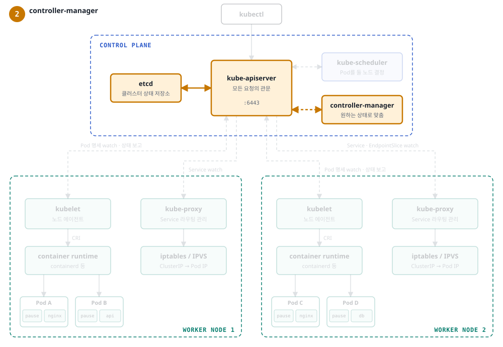
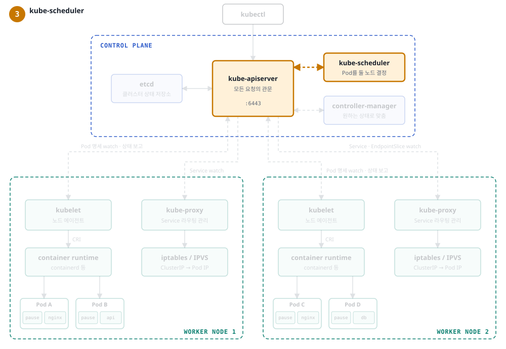
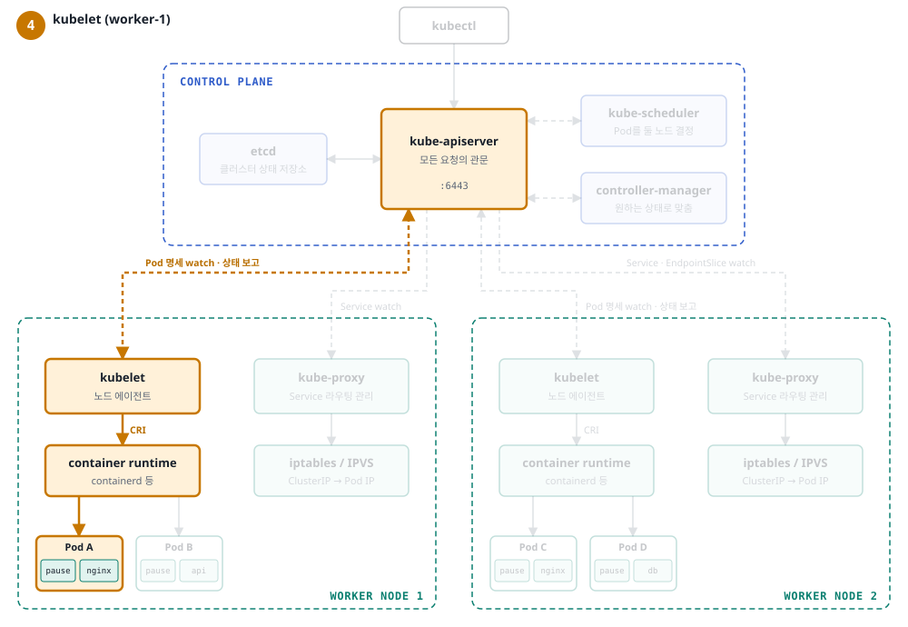
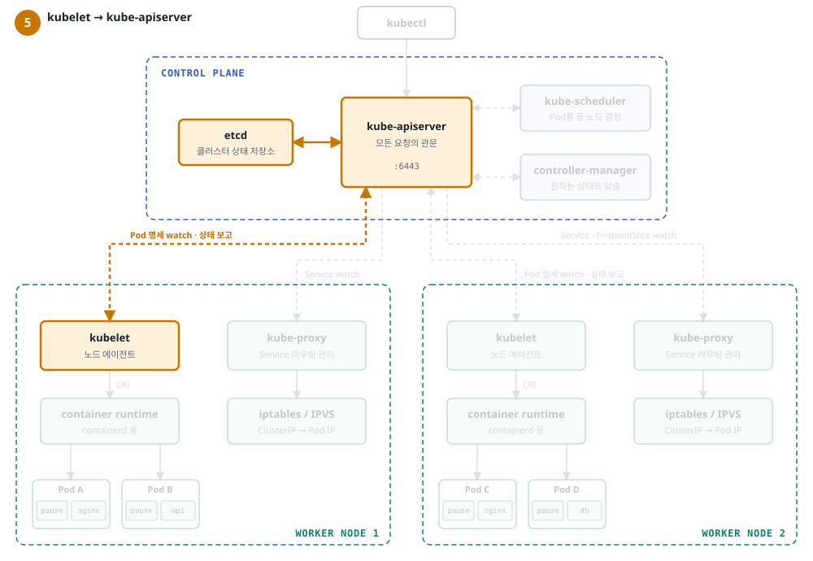
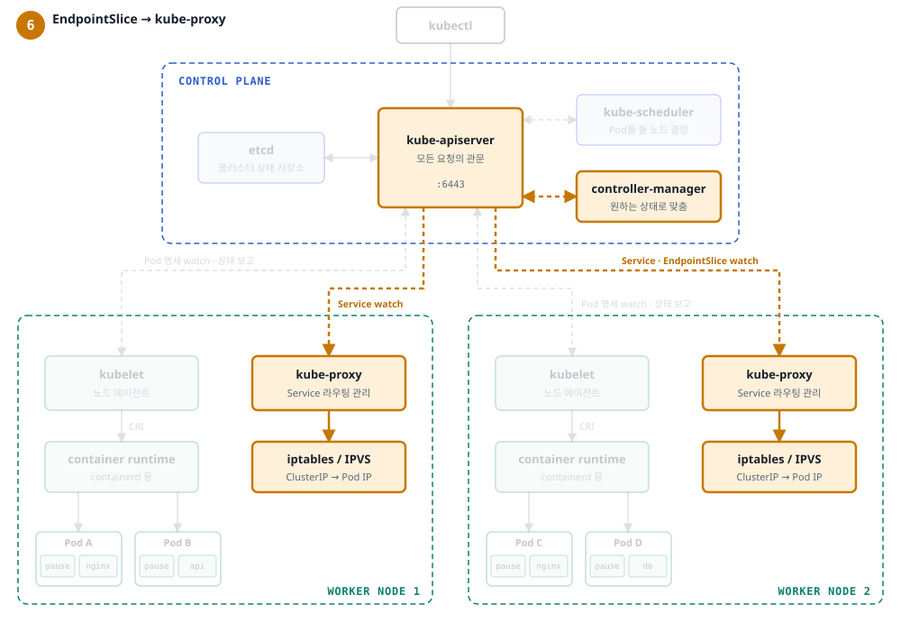

# kubernetes - basic

## k8s가 필요한 이유
docker를 통해서 다양한 환경에서 쉽게 이미지를 통해 배포 환경을 구축할 수 있다. 하지만 docker만 사용했을 때의 문제점은 무엇일까

- 장애 복구 : 컨테이너가 죽으면 수동으로 재시작을 해야한다.
- Scale out : 트래픽 증가 시 수동으로 컨테이너 추가
- 배포 : 서비스 중단 후 새 버전 배포
- 관리 : 서버마다 개별 접속해서 관리

### self healing
k8s는 항상 현재 상태를 관리하면서 서버가 다운된 것을 추적하고 있다.
<br>
특정 상태를 선언하면 그 선언을 유지하려 한다.

ex)
```
pod 3개를 유지

1. 컨테이너 이상(프로세스 종료, liveness 실패) → kubelet이 같은 pod 안에서 컨테이너 재시작
2. pod 자체가 사라짐(삭제, 노드 장애) → ReplicaSet이 3개를 맞추려고 새로운 pod 생성
```

### auto scaling
cpu나 메모리 사용량을 기준으로 pod의 수를 조절한다.

### load balancing
한 pod에 집중하는 것을 방지하기 위해 부하를 분산한다.

### rolling update
점진적으로 하나씩 새로운 업데이트를 진행하면서 교체한다.

## k8s의 철학
k8s는 선언적 관리를 추구한다.

ex
```
Desired State: container가 3개여야한다.
Controller Manager: 상태 비교 및 조정

현재 상태를 기반으로 선언한 상태를 맞추려고 한다.
```

## 용어

### Pod
k8s에서 관리되는 가장 작은 배포 단위
- pod에는 1개 이상의 컨테이너가 포함되어있다.
- 같은 IP, localhost 통신을 공유한다. 스토리지는 같은 volume을 마운트했을 때만 공유한다.
- pod는 일시적이고 pod가 다시 띄워질때마다 새로 IP를 발급받는다.

[사이드카 패턴]
```
일반적으로는 1개의 pod는 1개의 container가 있지만 특수한 상황에서는 1개의 pod에 여러 컨테이너가 있을 수 있다.
이를 사이드카 패턴이라한다.

내부 예시는 웹앱 & 로그 수집 컨테이너와 같다
```

[pod 관리]
```
kubectl apply -f first-pod.yaml                
pod/my-first-pod created

kubectl get pods -o wide
NAME           READY   STATUS    RESTARTS   AGE    IP           NODE    NOMINATED NODE   READINESS GATES
my-first-pod   1/1     Running   0          111s   10.244.0.3   start   <none>           <none>
```
- `kubectl describe pod {pod-name}`: pod 상세 정보 확인 및 events로 실행 내력 확인
- `kubectl logs {pod-name}`: 로그확인
- `kubectl exec -it {pod-name} -- /bin/bash`: pod 접속
- `kubectl delete pod {pod-name}`

하지만 pod만 생성하게 되면 k8s의 장점인 고가용성을 가져갈 수 없기 때문에 실제 앱 배포단위인 deployment를 사용하고, 바뀌는 pod IP 대신 고정된 주소로 접근하기 위해 service를 사용

### Deployment
실제로 작성하는 앱 배포 단위, pod를 직접 만들게 되면 `replica`, `rolling update`가 불가능하고 `self healing`도 일부만 된다.
- pod만 있으면 컨테이너가 죽었을 때 kubelet이 재시작은 해주지만, pod가 삭제되거나 노드가 죽으면 아무도 다시 만들지 않는다.
- label은 리소스에 붙이는 태그, key와 value 형태
- selector: label을 기준으로 리소스를 선택

```
kubectl apply -f deployment.yaml
```

[결과]
```
kubectl get deployment

NAME               READY   UP-TO-DATE   AVAILABLE   AGE
nginx-deployment   3/3     3            3           49s
```
- ready: 준비된 pod 수 / 원하는 pod 수(replicas)
- up-to-date: 최신 템플릿(현재 버전)으로 만들어진 pod 수. 롤링 업데이트 중에는 점점 늘어난다
- available: Ready가 되어 실제로 트래픽을 받을 수 있는 pod 수

[replicaset 확인]
```
kubectl get replicaset 

NAME                          DESIRED   CURRENT   READY   AGE
nginx-deployment-6f8d5bcb9f   3         3         3       3m57s
```
- replicaSet : pod를 정확히 N개 유지하기 위한 set

[pod replica 갯수 변경]
```
kubectl scale deployment nginx-deployment --replicas=5
```
- 위 명령은 사람이 직접 숫자를 바꾸는 수동 스케일링
- 오토스케일링은 HPA(Horizontal Pod Autoscaler)가 CPU/메모리 사용량을 보고 replicas를 자동으로 조절한다


[rolling update]
```
kubectl set image deployment/nginx-deployment nginx=nginx:1.25
kubectl rollout status deployment/nginx-deployment

# 확인
kubectl describe deployment nginx-deployment | grep Image
kubectl get replicasets

# rollback
kubectl rollout undo deployment/nginx-deployment
```

### Service
deployment까지 했다면 배포가 가능한데 이제 문제는 ip가 된다.
- pod는 꺼지고 다시 켜질때마다 ip가 변경
- ip자체가 클러스터 내부에서 접근하다보니 외부에서 직접 접근 불가 

따라서 service가 pod 앞에서 고정 IP(ClusterIP)와 DNS 이름을 제공해서, pod가 바뀌어도 같은 주소로 접근할 수 있게 한다

[ClusterIP]
```
kubectl apply -f service-deployment.yaml

# 확인
kubectl get services
kubectl describe service nginx-service

# 접속 확인
kubectl run test-pod --image=curlimages/curl --rm -it -- sh
curl nginx-service:80
```
- Endpoints : pod들의 주소

[NodePort]
```
kubectl apply -f service-deployment-nodeport.yaml

# IP 확인후 외부에서 접속
minikube -p {name:study} ip
curl {ip}:30080

# minikube에 접속
minikube -p study ssh
curl localhost:30080

# minikube에서 터널을 열어주는 방법
minikube -p {name} service nginx-nodeport --url
```

[역할]
- load balancing 기능
- service discovery 기능

[유형]
- ClusterIP: 내부에서만 접근 가능
  - db같은 경우에는 외부에서 접근 안되게 DB service를 ClusterIP로
- NodePort: `노드IP:포트`로 클러스터 밖에서 접근 가능
   - 개발이나 테스트에서 사용, 운영에서는 ingress
   - 모든 노드에 30000~32767 포트를 열어 `노드IP:포트`로 접근. 노드 IP에 닿을 수 있는 곳에서만 접근 가능
- LoadBalancer: 클라우드 LB를 만들어 외부 IP 부여 (운영에서 외부 공개)
  - NodePort + ClusterIP를 포함 (외부 LB → 노드의 NodePort → pod)
  - 서비스마다 LB가 생겨 비용 ↑ → 보통 LB 1개 + Ingress로 여러 서비스 분기
  - minikube에서는 EXTERNAL-IP가 `<pending>` → `minikube tunnel` 필요
- ExternalName: 내부 이름을 외부 도메인으로 연결 (DNS CNAME)
  - 외부 RDS 등을 클러스터 안에서 `mysql` 같은 이름으로 부를 때
  - pod, 프록시 없이 이름만 바꿔주는 별칭
- (변형) Headless: `clusterIP: None`, DNS가 대표 IP 대신 pod IP 목록을 반환
  - StatefulSet과 함께 특정 pod(`mysql-0.mysql`)에 직접 접근할 때

> Ingress는 Service 유형이 아니라 별도 오브젝트. HTTP 도메인/경로 기준으로 여러 Service에 분기한다.
> ```
> 외부 → LoadBalancer → Ingress Controller ─┬─ /api → spring Service (ClusterIP)
>                                          └─ /    → front Service (ClusterIP)
> ```

- endpointSlice : 실제 pod IP 목록


## k8s의 아키텍처
크게 2개로 나뉜다. control plane & worker node
- control plane : 클러스터를 관리하고 결정하는 곳
- worker node : pod(컨테이너)가 실제로 실행되는 노드




### control plane

[kube-apiserver]
```
클러스터의 유일한 입구.

각 요청
인증 -> 인가(RBAC) -> Admission -> etcd
```
- 다른 컴포넌트에 변경 사항을 watch 스트림으로 전달
- 장애 시: kubectl이 동작하지 않고 새 변경이 반영되지 않는다. 실행중인 pod는 그대로 동작

[etcd]
```
모든 리소스의 원하는 상태와 현재 상태를 저장하는 분산 key-value 저장소

여러 대가 같은 데이터를 갖고, Raft로 과반수가 동의해야 쓰기가 확정된다.
그래서 3대(1대 장애 허용), 5대(2대 장애 허용)처럼 홀수로 운영한다. (4대는 3대와 똑같이 1대만 견딤)
```
- 장애 시: api 서버가 읽기나 쓰기를 못한다
- 데이터를 잃으면 클러스터 상태 전체를 잃어서 스냅샷 백업이 필수

[kube-scheduler]
```
새로운 pod를 어느 노드에서 돌릴지 정하는 컴포넌트 (정하기만 하고 실행은 kubelet)
```
1. 대상 찾기 : API 서버를 watch 하다가 spec.nodeName이 비어있는 pod를 발견하면 스케쥴링 큐에 넣는다. (pending상태)
2. Filtering
    - 리소스 : 노드에 남은 CPU, 메모리가 pod의 requests보다 적으면 탈락
    - taint/toleration : 노드에 붙은 taint표시를 pod가 허용하지 않으면 탈락
    - nodeSelector/affinity: pod가 원하는 라벨이 없는 노드는 탈락
    - hostPort 충돌 및 볼륨이 붙을 수 있는 영역도 확인
3. Scoring: 남은 노드들 중 점수를 매겨 가장 높은 노드 선택
    - 리소스가 많을수록
    - 이미지를 이미 받아 둔 노드
    - 같은 앱의 pod가 덜 몰린 노드
4. binding: 고른 노드 이름을 API 서버에 기록, nodeName이 채워지고 Scheduled 이벤트 남김

[controller-manager]
```
Deployment, ReplicaSet, Node, EndpointSlice 같은 컨트롤러를 한 프로세스에 모아둔 컴포넌트
```
- 원하는 상태와 현재 상태를 비교해서 차이를 메우는 reconcile 루프를 돈다
- 장애 시: self healing 중단, pod가 죽어도 다시 만들지 않고 replicas 변경도 반영 안 됨

### Worker Node

[kubelet]
```
자기 노드에 배정된 pod를 watch, CRI로 런타임에 생성 요청
```
- liveness/readiness probe를 실행하고 노드와 pod상태를 주기적으로 보고
- `kubectl logs/exec`는 api 서버가 kubelet의 10250 포트로 연결
- 장애 시: 노드는 NotReady, 기본 300초(unreachable/not-ready toleration) 뒤에 그 노드의 pod가 다른 노드로 옮겨진다.

[kube-proxy]
```
Service와 EndpointSlice를 watch해서 노드의 iptables나 IPVS규칙을 갱신
```
- ClusterIP로 들어온 패킷을 실제 pod ip로 바꾸는 일은 커널에서 진행
- 장애 시: 이미 만든 규칙은 그대로 동작, 새로 생기거나 사라진 pod는 반영 안 됨

[container runtime]
```
containerd나 CRI-O가 이미지를 받고 namespace와 cgroup을 설정해서 컨테이너 실행
```
- kubelet과는 CRI(gRPC)로 통신

### 동작 순서
`kubectl apply -f deployment.yaml` 요청을 사용자가 보냈을때 동작 순서

> 그림은 worker 노드 2개로 그렸지만, 실습 클러스터(minikube `study`)는 노드가 `study` 하나라서 모든 pod가 `study`에 배치된다. 아래 이름과 IP는 실습 클러스터의 실제 값.

[1. kubectl -> kube-apiserver]

```
인증, RBAC 인가, Admission 검사를 거쳐 Deployment객체를 etcd에 저장

+ Deployment/nginx-deployment   replicas: 3
+ Service/nginx-service        clusterIP: 10.109.5.189
```

[2. controller-manager]

```
- Deployment 컨트롤러 : replicaSet을 만든다
- ReplicaSet 컨트롤러 : 원하는 pod 갯수 만큼 pod를 만든다.

+ ReplicaSet/nginx-deployment-6f8d5bcb9f        replicas: 3
+ Pod/nginx-deployment-6f8d5bcb9f-dvwr4         nodeName: (없음)  Pending
+ Pod/nginx-deployment-6f8d5bcb9f-j4t2p         nodeName: (없음)  Pending
+ Pod/nginx-deployment-6f8d5bcb9f-zjnvv         nodeName: (없음)  Pending
```

[3. kube-scheduler]

```
스케쥴러가 watch로 nodeName이 빈 pod 받는다.
Pod마다 노드를 고른다
- Filtering, Scoring, Binding

~ Pod/nginx-deployment-6f8d5bcb9f-dvwr4   nodeName: study
~ Pod/nginx-deployment-6f8d5bcb9f-j4t2p   nodeName: study
~ Pod/nginx-deployment-6f8d5bcb9f-zjnvv   nodeName: study
```
- pending상태이고 노드만 정해진 상태

[4. kubelet (worker-1)]

```
CRI(gRPC)로 containerd에 요청
1. pause 컨테이너를 먼저 띄워 pod용 namespace(network, ipc, uts)를 만든다.
2. CNI 플러그인이 veth를 만들어 노드에 연결하고 pod ip를 붙인다
3. 이미지를 받고 컨테이너를 pause의 namespace에 같이  실행 후 cgroup에 자원 제한 적용

study 노드:  pause + nginx 프로세스 실행 중, IP 10.244.0.39 (dvwr4)
```
- 노드에서는 돌고 있지만 API서버는 아직 모른다.


[5. kubelet -> kube-apiserver]

```
kubelet이 pod 기록의 status 부분을 api 서버에 갱신

~ Pod/nginx-deployment-6f8d5bcb9f-dvwr4   phase: Running
                                          podIP: 10.244.0.39
                                          Ready: True
```

[6. EndpointSlice -> kube-proxy]

```
1. EndpointSlice 컨트롤러가 Pod IP를 Service의 엔드포인트 목록에 넣는다.
2. 모든 노드의 kube-proxy가 이 변경을 받아 노드의 iptables 규칙을 갱신

~ EndpointSlice/nginx-service-c948w   10.244.0.39:80, 10.244.0.40:80, 10.244.0.38:80
# study 노드의 iptables
+ 10.109.5.189:80 → 위 3개 Pod IP 중 하나로 전달
```