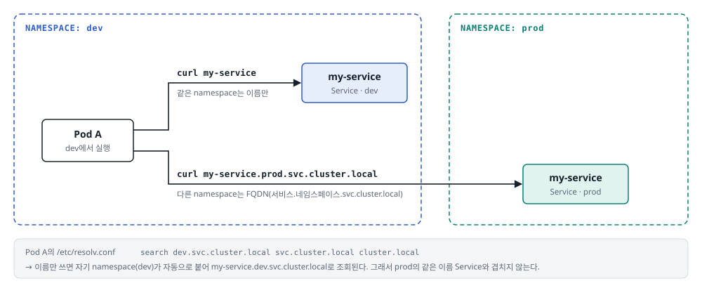

# Namespace를 통한 리소스 Grouping

## Namespace
하나의 클러스터안에서 리소스를 논리적으로 분리

### 사용 이유
1. 환경 분리: dev, stage, prod환경을 분리
2. 팀별 분리: 팀A, 팀B형태로 리소스나 접근권한을 팀별로 분리

```
kubectl get ns

NAME              STATUS   AGE
default           Active   76d
kube-node-lease   Active   76d
kube-public       Active   76d
kube-system       Active   76d
```

### 생성
```
# 명령어
kubectl create namespace {}

# yaml
kubectl apply -f namespace.yaml
```

[pod 적용]
```
metadata.namespace: {생성한 namespace}
```
- `kubectl get pods` <= 해당 명령어로는 확인 불가
- `kubectl get pods -n {namespace}` 


### 접근
```
같은 namespace에 있는 서비스들 간 접근은 단순 서비스명을 통해서 접근이 가능하지만
다른 서비스의 경우

other-service.namespace.svc.cluster.local과 같이 접근한다
```



# ConfigMap
application의 설정을 관리하기 위한 기능.

[configmap 생성]
```
kubectl apply -f configmap.yaml
```
- 일반적으로 유지보수를 생각했을때 yaml을 사용한다

## POD 주입
pod에 적용할 수 있는 방법은
1. 환경 변수 주입
2. 파일로 마운트