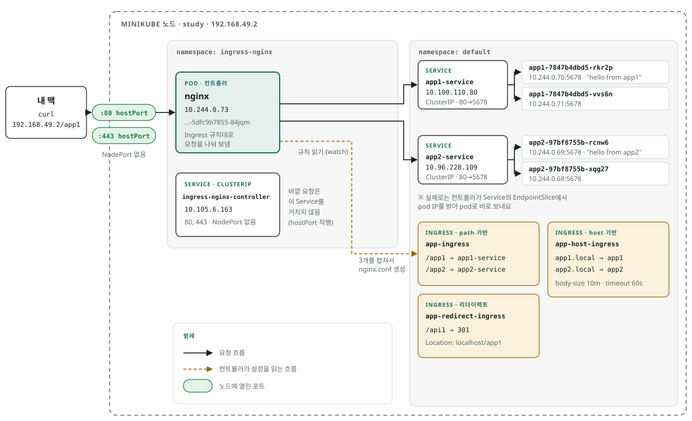

# Ingress 방식
외부 http, https와 같은 트래픽을 cluster 내부 서비스로 라우팅하는 방식

## NodePort의 한계
- 서비스마다 다른 port 사용해야함
- 30000~32767 사이에서만 사용 가능
- L4(TCP) 수준이라 L7 라우팅 불가 : path, host 기반 라우팅 불가
- https를 위한 tls, ssl 인증서 관리 어렵다

## Ingress
cluster 앞에 위치하는 http load balancer
- Ingress 리소스 자체는 라우팅 **규칙**이고, 실제로 요청을 받아 처리하는 건 Ingress Controller

### Ingress Controller

## 실습 아키텍처
`labs/ingress`로 구성한 환경 (minikube, 노드 1개 `study`)



[구성 요소]

| 파일 | 리소스 | 역할 |
|---|---|---|
| (직접 설치 + 패치) | ingress-nginx-controller (namespace: ingress-nginx) | Ingress 규칙을 읽어 nginx 설정을 만들고 요청을 나눠 보냄. 노드 80/443을 hostPort로 받음 |
| app1.yaml | Deployment app1 (pod 2개) + app1-service | `hello from app1` 응답 (hashicorp/http-echo, 5678) |
| app2.yaml | Deployment app2 (pod 2개) + app2-service | `hello from app2` 응답 |
| ingress.yaml | app-ingress | path 기반: `/app1`, `/app2` |
| ingress-host.yaml | app-host-ingress | host 기반: `app1.local`, `app2.local` + annotation(body-size, timeout) |
| ingress-redirect.yaml | app-redirect-ingress | `/api1` → 301 `http://localhost/app1` |

[요청 흐름]
```
curl → 노드 192.168.49.2:80 (hostPort)
     → 컨트롤러 pod (nginx) : Ingress 규칙(path / host)으로 목적지 결정
     → app1 / app2 pod (5678)
```
- 바깥에서 들어오는 입구는 노드 80번 하나. 앱 Service는 둘 다 ClusterIP, NodePort는 쓰지 않는다
- 컨트롤러는 Service의 ClusterIP를 거치지 않고, EndpointSlice에서 pod IP를 받아 pod로 바로 보낸다
- Ingress 리소스는 트래픽이 지나가는 곳이 아니라 **규칙**. 컨트롤러가 watch해서 nginx.conf로 합친다

[NodePort를 없앤 방법]
- 처음 설치한 컨트롤러 Service는 LoadBalancer 타입 → LoadBalancer는 NodePort 위에 쌓인 구조라 NodePort(`80:30386`)가 자동으로 생긴다
- minikube에는 외부 IP를 줄 LB가 없어서 `EXTERNAL-IP <pending>`, 결국 30386으로만 접속 가능했다
- 그래서 컨트롤러 pod에 hostPort를 걸고, Service는 ClusterIP로 변경 (minikube ingress 애드온도 hostPort 방식)

```
# 노드 80/443 → 컨트롤러 pod 80/443 직접 연결
kubectl patch deploy -n ingress-nginx ingress-nginx-controller --type=json -p='[
 {"op":"add","path":"/spec/template/spec/containers/0/ports/0/hostPort","value":80},
 {"op":"add","path":"/spec/template/spec/containers/0/ports/1/hostPort","value":443}]'

# LoadBalancer → ClusterIP (NodePort 제거)
kubectl patch svc -n ingress-nginx ingress-nginx-controller --type=json -p='[
 {"op":"replace","path":"/spec/type","value":"ClusterIP"},
 {"op":"remove","path":"/spec/ports/0/nodePort"},
 {"op":"remove","path":"/spec/ports/1/nodePort"},
 {"op":"remove","path":"/spec/externalTrafficPolicy"}]'
```
- hostPort: 노드의 포트를 pod의 포트에 직접 연결. Service, kube-proxy를 거치지 않는다
- 클러스터에만 반영한 변경이라 컨트롤러를 다시 설치하면 원래대로(LoadBalancer + NodePort) 돌아간다

[테스트]
```
# path 기반
curl http://192.168.49.2/app1        # hello from app1
curl http://192.168.49.2/app2        # hello from app2

# host 기반 (Host 헤더로 도메인 지정)
curl -H "Host: app1.local" http://192.168.49.2/

# 리다이렉트 (301 + Location 확인)
curl -i http://192.168.49.2/api1     # Location: http://localhost/app1
```
- 리다이렉트 목적지가 `localhost`라서 `curl -L`로 따라가면 맥의 localhost:80(닫힘)으로 가서 실패한다
