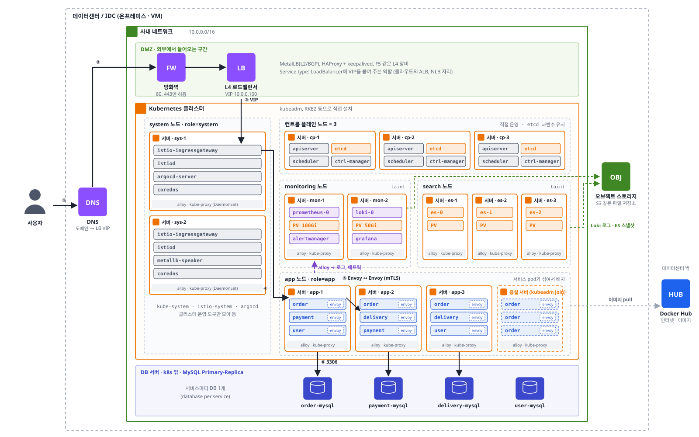

# Istio
k8s를 위한 서비스 메시(Service Mesh)

```
서비스와 서비스 사이의 통신(트래픽 제어, 보안, 관측)을
앱 코드를 고치지 않고 인프라 계층에서 처리해주는 도구
```
- 서비스 메시 : 서비스 간 통신을 전담하는 네트워크 계층
- 앱은 그냥 `http://order-service`로 요청하고, 재시도, 타임아웃, 암호화, 트래픽 분배는 Istio가 처리

## 사용 이유
MSA로 서비스가 수십 개가 되면 서비스 간 통신 문제가 생긴다
- 호출 경로가 기하급수적으로 늘어난다.
- 특정 사용자에게만 신규 버전을 노출하는 header기반 라우팅
- 신규 배포에 안정성을 늘리기 위한 트래픽 분산
- 시스템간 장애를 전파하지 못하게 하는 재시도나 차단

이런 기능들을 애플리케이션 코드에 구현하는게 말이 안된다.
언어와 프레임워크가 제각각이라서 표준화 어렵고 정책하나 바꾼다고 전부 바꿀 수는 없다.

그래서 서비스 mesh가 나왔다
- 비즈니스 로직과 네트워크 로직을 분리해서 통신 계층 일을 전부 네트워크 layer에서 처리
- 이런 처리를하는 것이 사이드카 프록시이고 이런 사이드카 패턴을 구현한 구현체가 Istio

[서비스 메시가 해결하는 것]
- 통신 정책을 YAML로 선언 → 코드 수정 없이 모든 서비스에 같은 방식으로 적용
- 서비스 간 mTLS 자동 적용 (인증서 발급, 갱신도 자동) → 평문 통신, 서비스마다 인증서 관리 문제 해결
- 모든 요청의 메트릭, 트레이스를 자동 수집 → 어느 서비스에서 느려졌는지 추적
- 트래픽을 비율, 헤더 기준으로 분배 → k8s Service는 pod에 골고루 분배만 해서 "v2에 10%만"은 replicas 비율로 흉내 낼 수밖에 없다

## 구조
컨트롤 플레인 + 데이터 플레인

```
            ┌─────────── istiod (컨트롤 플레인) ───────────┐
            │  설정 배포, 인증서 발급, 서비스 목록 관리      │
            └──────────────┬───────────────┬──────────────┘
                     설정 전달 │                │ 설정 전달
        ┌──────── pod A ───────┐        ┌──────── pod B ───────┐
        │ app ↔ envoy(sidecar) │ ─mTLS→ │ envoy(sidecar) ↔ app │
        └──────────────────────┘        └──────────────────────┘
                         데이터 플레인 (실제 트래픽이 지나가는 곳)
```

| 구성 요소 | 역할 |
|---|---|
| istiod | 컨트롤 플레인. VirtualService 같은 설정을 Envoy 설정으로 바꿔 각 sidecar에 전달, mTLS 인증서 발급 |
| Envoy (sidecar) | 데이터 플레인. pod마다 붙는 프록시. 들어오고 나가는 모든 트래픽이 거쳐간다 |
| istio-ingressgateway | 클러스터 밖 → 안으로 들어오는 트래픽의 입구 (Envoy로 동작) |

- istiod는 k8s 컨트롤 플레인(kube-system)과 다른 것. k8s 입장에서는 istio-system에 뜬 일반 Deployment
- 컨트롤 플레인(istio-system)과 앱(default 등)을 namespace로 분리 → 권한(RBAC), 실수로 삭제, sidecar 주입 대상을 분리

[sidecar 주입]
```
kubectl label namespace default istio-injection=enabled
```
- `istio-injection`은 스위치 역할의 label. 실제로 Envoy를 넣는 건 istiod의 Mutating Admission Webhook
  - pod 생성 요청 → API 서버가 webhook 호출 → istiod가 pod spec에 컨테이너를 추가해서 돌려준다
  - `istio-init` (init container) : iptables 규칙으로 pod의 트래픽을 Envoy로 돌린다
  - `istio-proxy` : Envoy 본체
- 그래서 pod가 `READY 2/2` (app + istio-proxy)
- 이미 떠 있는 pod에는 적용되지 않는다 → 재시작해야 주입됨 (`kubectl rollout restart deployment/{name}`)
- 앱은 프록시가 있는지 모른다. 내가 작성한 Deployment YAML도 바뀌지 않는다
- 특정 pod만 제외 : pod에 `sidecar.istio.io/inject: "false"` label

[Ambient 모드]
- sidecar 없이 노드마다 뜨는 ztunnel(L4)과 필요할 때만 두는 waypoint proxy(L7)로 동작하는 새 방식
- pod마다 Envoy를 붙이지 않아서 리소스 사용량이 적다

## 전체 구성 예시
order, payment, delivery, user 서비스 + 모니터링 + Elasticsearch + MySQL을 직접 운영하는 k8s에 올린 경우



[요청 흐름]
1. 사용자 → DNS로 도메인 조회
2. 방화벽 → L4 로드밸런서(VIP)
3. LB → `istio-ingressgateway` (Gateway, VirtualService 규칙으로 어느 서비스로 갈지 결정)
4. ingressgateway → order pod (order의 Envoy가 먼저 받아서 앱에 전달)
5. order가 `http://payment-service`로 호출 → order의 Envoy가 가로채서 재시도, 타임아웃 적용 + mTLS로 암호화 → payment의 Envoy가 받아서 접근 제어 확인 후 앱에 전달
6. 각 서비스 → 자기 DB (database per service)

[배치]
- 서비스 pod는 서비스마다 서버를 따로 두지 않고 app 노드들에 섞여서 뜬다. 격리는 컨테이너가, 자원 보장은 requests, limits가 담당
- 앱 pod에만 Envoy가 붙는다 (app namespace에만 `istio-injection` label)
- istiod, ingressgateway는 system 노드, Prometheus, Loki는 monitoring 노드, ES는 search 노드 → taint로 앱 pod가 못 들어오게 분리
- Grafana Alloy는 DaemonSet → 모든 노드에서 로그, 메트릭 수집
- Loki 로그, ES 스냅샷은 오브젝트 스토리지(S3 같은 파일 저장소)에, 이미지는 Docker Hub에서 받는다
- scale-out : HPA가 pod를 먼저 늘리고, 자리가 없어 Pending이 되면 노드(서버)를 추가 (클라우드면 Karpenter 같은 도구가 자동으로)
- 새 pod에도 Envoy가 자동으로 붙고, istiod가 다른 Envoy들에게 새 pod 주소를 알려준다

## 핵심 리소스

| 리소스 | 역할 |
|---|---|
| Gateway | 클러스터 밖에서 들어오는 입구 (포트, host, TLS) |
| VirtualService | 요청을 **어디로** 보낼지 : 경로, 헤더, 비율 라우팅, 재시도, 타임아웃 |
| DestinationRule | 보낸 곳에서 **어떻게** 처리할지 : subset(v1, v2) 정의, 로드밸런싱, 서킷 브레이커 |
| PeerAuthentication | 서비스 간 mTLS 적용 여부 (istio-system에 두면 mesh 전체에 적용) |
| AuthorizationPolicy | 어떤 서비스가 어떤 서비스를 호출할 수 있는지 (접근 제어) |
| ServiceEntry | 클러스터 밖 서비스(외부 API, DB)를 mesh에 등록 |

- VirtualService와 DestinationRule은 거의 항상 같이 쓴다
- 위 구성에서 필요한 것 : Gateway 1개, 외부 노출되거나 규칙이 필요한 서비스만 VirtualService, DestinationRule. 아무 규칙이 없는 서비스도 mTLS, 메트릭은 자동 적용

## istioctl
istio설치 도구뿐만아니라 트러블 슈팅에서도 사용한다.
- 사이드카 설정
- cluster의 istio 설정

[설치]
```
curl -L https://istio.io/downloadIstio | sh -
```

[트러블 슈팅]

| 명령어 | 보는 것 |
|---|---|
| `istioctl analyze` | 설정 YAML의 정합성 (정적 검사). 없는 Gateway, subset 참조, injection label 누락 등 |
| `istioctl proxy-status` | istiod의 설정이 각 Envoy에 반영됐는지 (SYNCED, STALE) |
| `istioctl proxy-config routes {pod}` | 특정 pod의 Envoy가 실제로 들고 있는 라우팅 설정 |

- `analyze` : "설정을 잘못 썼나?" / `proxy-status`, `proxy-config` : "Envoy에 실제로 들어갔나?"
- `istioctl analyze my-vs.yaml` : apply 전에 로컬 파일을 클러스터 설정과 합쳐서 검사

## Ingress vs Istio

| 구분 | Ingress (ingress-nginx) | Istio |
|---|---|---|
| 담당 트래픽 | 밖 → 클러스터 안 (North-South) | 밖 → 안 + **서비스 ↔ 서비스** (East-West) |
| 위치 | 클러스터 입구 한 곳 | 입구 + 모든 pod 옆 (sidecar) |
| 라우팅 | path, host | path, host, 헤더, 비율 |
| 서비스 간 통신 | 관여하지 않음 | 재시도, 타임아웃, mTLS, 접근 제어 |
| 복잡도 | 낮음 | 높음 |

- Istio를 쓰면 입구도 보통 Istio Gateway로 통일한다

## 관측 (Observability)
모든 트래픽이 Envoy를 지나가므로 앱 코드 없이 수집된다

| 도구 | 보는 것 |
|---|---|
| Prometheus | 요청 수, 에러율, 응답 시간 메트릭 |
| Grafana | 메트릭 대시보드 |
| Jaeger / Zipkin | 요청 하나가 거쳐간 서비스 경로와 구간별 시간 (분산 트레이싱) |
| Kiali | 서비스 간 호출 관계를 그래프로 시각화 |

- 트레이싱은 앱이 요청 헤더(`x-request-id`, `traceparent` 등)를 다음 요청에 그대로 넘겨줘야 이어진다 → 이 부분만은 코드 수정 필요

## 단점
- pod마다 Envoy가 붙어서 CPU, 메모리 사용량 증가
- 요청마다 프록시를 두 번(보내는 쪽, 받는 쪽) 거쳐서 지연 시간이 조금 늘어난다
- 리소스 종류가 많고 학습 비용이 크다. 장애가 나면 앱 문제인지 mesh 문제인지 구분하기 어렵다
- 서비스가 적으면 오버엔지니어링 → 서비스 수가 많고, 서비스 간 통신 제어가 필요할 때 도입

## 다른 도구와의 관계
- Ingress([06](06-k8s-ingress.md)) : 입구 역할을 Istio Gateway가 대신할 수 있다
- 배포 전략([10](10-k8s-deploy-strategy.md)) : Canary를 replicas 비율이 아니라 정확한 트래픽 비율로 할 수 있다
- Argo Rollouts : Istio의 VirtualService weight를 자동으로 조절하면서 Canary를 진행한다
- Prometheus, Grafana([08](08-k8s-monitoring.md)) : Istio 메트릭을 그대로 수집
